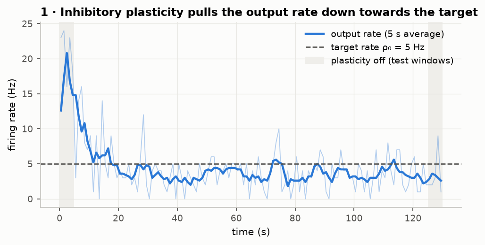
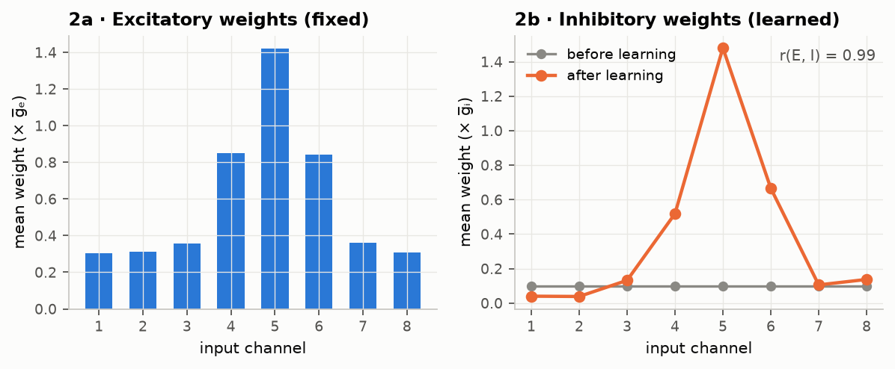
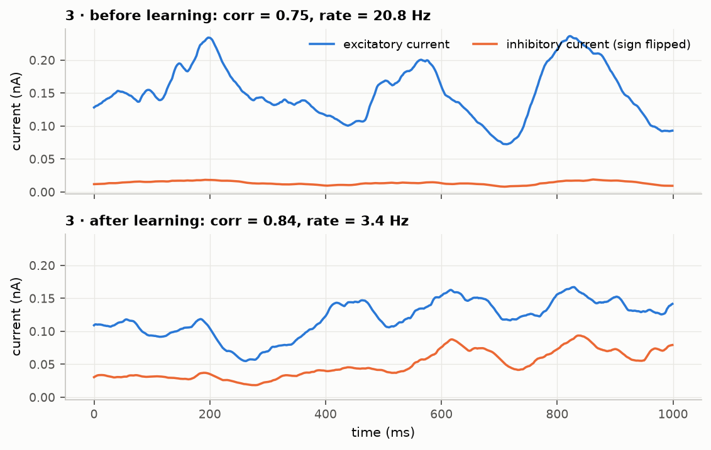
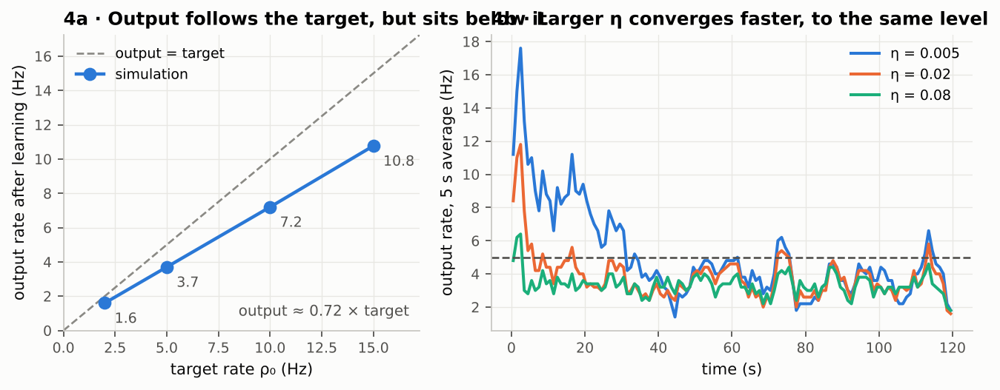
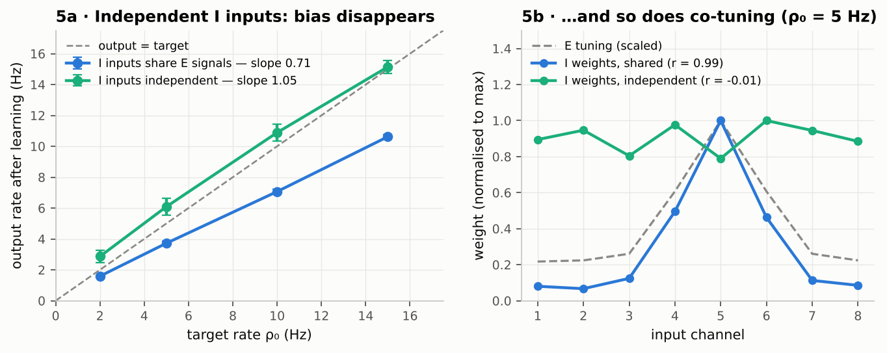
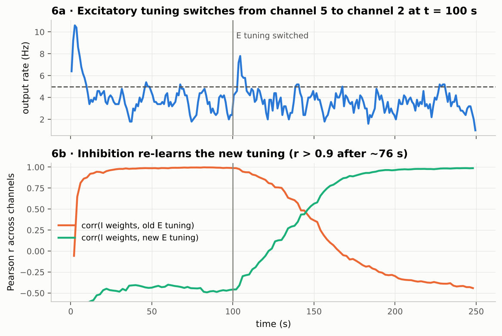

# Inhibitory plasticity and E/I balance — a single-neuron reimplementation

A simplified reimplementation of the single-neuron model from

> Vogels, T. P., Sprekeler, H., Zenke, F., Clopath, C., & Gerstner, W. (2011).
> *Inhibitory plasticity balances excitation and inhibition in sensory pathways and memory networks.* Science, 334(6062), 1569–1573.

written in Python with [Brian2](https://brian2.readthedocs.io/), plus three additional experiments: where the rate actually settles, why it settles there, and whether inhibition re-learns after excitation changes.

## Question

A neuron receives excitatory input that is strongly tuned to one input pathway. Its inhibitory synapses start out weak and untuned. Can a simple, local spike-timing rule at the inhibitory synapses alone:

1. bring the neuron's firing rate down to a target value, and
2. make inhibition *co-tuned* with excitation, so that the two currents track each other over time (detailed balance)?

## Model

| Component | Setup |
|---|---|
| Neuron | Conductance-based leaky integrate-and-fire. C = 200 pF, g_L = 10 nS (τ_m = 20 ms), E_L = −60 mV, V_th = −50 mV, 5 ms refractory |
| Synapses | E_exc = 0 mV, τ_exc = 5 ms; E_inh = −80 mV, τ_inh = 10 ms |
| Inputs | 8 independent pathways ("channels"), each with 100 excitatory and 25 inhibitory Poisson inputs (1,250 total) |
| Input signals | Each channel's rate is a rectified Ornstein–Uhlenbeck process (τ = 50 ms, mean ≈ 7 Hz), shared by all E and I inputs of that channel |
| Excitatory weights | Fixed tuning curve, peaked on channel 5: w_k = 0.3 + 1.1 / (1 + (k − 5)⁴), ±10 % noise |
| Inhibitory weights | Start uniform (0.1 × ḡ_I), then learn |

**Inhibitory plasticity rule (iSTDP).** Every synapse keeps a presynaptic trace `Apre` and a postsynaptic trace `Apost`, both decaying with τ_STDP = 20 ms.

- presynaptic spike: `w ← w + η (Apost − α)`
- postsynaptic spike: `w ← w + η Apre`

with α = 2 ρ₀ τ_STDP. Near-coincident pre/post spikes (in either order) strengthen inhibition. Every presynaptic spike also weakens it by a constant α. If pre and post spikes are uncorrelated, the two terms cancel exactly when the postsynaptic rate equals ρ₀. The rule therefore works as a homeostatic set-point for the neuron's output rate.

Protocol: 5 s with plasticity off (baseline) → 120 s of learning (η = 0.02, ρ₀ = 5 Hz) → 5 s with plasticity off (test).

## Results

### 1. Firing rate drops from ~21 Hz to near the target



### 2. Inhibition becomes co-tuned with excitation



The plasticity rule never sees the excitatory weights. Even so, the learned inhibitory weights reproduce the excitatory tuning curve (Pearson r = 0.99 across channels). This happens because each inhibitory synapse is potentiated in proportion to how often its spikes coincide with output spikes. Inputs from channels that drive the neuron strongly coincide more often.

### 3. Excitatory and inhibitory currents track each other



Before learning, the inhibitory current is small and almost flat. After learning, it is about 3–4× larger and follows the fluctuations of the excitatory current: correlation of the low-passed currents rises from 0.75 to 0.84. This is a weaker version of the detailed balance reported in the paper (see *Differences* below).

| Metric | Before | After |
|---|---|---|
| Output rate | 20.8 Hz | 3.4 Hz |
| Corr(I_exc, −I_inh), 50 ms low-pass | 0.75 | 0.84 |
| Corr(E tuning, I tuning) across channels | — (I flat) | 0.99 |

## Own experiments

### Where does the rate actually settle?

In run 1 the output settled *below* the 5 Hz target. I tested whether this undershoot is a property of the rule's set-point or only a slow-learning artefact by varying:

- **ρ₀** ∈ {2, 5, 10, 15} Hz at fixed η = 0.02 (80 s of learning, rate averaged over the last 30 s);
- **η** ∈ {0.005, 0.02, 0.08} at fixed ρ₀ = 5 Hz (120 s).



**Findings**

- The output rate scales linearly with ρ₀, but at only about **0.72 × ρ₀** for every target tested.
- The learning rate changes *how fast* the rate converges (≈ 30 s for η = 0.005 vs a few seconds for η = 0.08). It does not change *where* the rate converges: all three runs end around 3.4–3.7 Hz.

**Hypothesis.** The cancellation argument behind α = 2ρ₀τ assumes that inhibitory input spikes and output spikes are uncorrelated. Here they are not. Each inhibitory input shares its rate signal with the excitatory inputs of its channel, and those excitatory inputs drive the output. Pre–post coincidences are therefore more frequent than chance, the rule over-potentiates inhibition, and the fixed point moves below ρ₀.

### Control: decorrelating inhibition from excitation

To test this, I drove the inhibitory inputs with rate signals generated independently of the excitatory ones. Everything else was unchanged. Each condition used 4 targets × 3 random seeds; error bars show the SD across seeds.



| Condition | Output / target (slope) | Co-tuning r at ρ₀ = 5 Hz (3 seeds) |
|---|---|---|
| I inputs share E channel signals | **0.71** | 0.99, 0.99, 0.99 |
| I inputs independent | **1.05** | 0.50, −0.39, −0.15 |

The hypothesis holds. Once inhibitory spikes are no longer correlated with the output, the neuron settles at the target rate, and the inhibitory weights stop following the excitatory tuning. The same input correlations that **create** co-tuning also **bias** the rate set-point. Detailed balance and exact rate control trade off against each other under this rule.

### Does inhibition follow when excitation changes?

After 100 s of learning, I moved the excitatory tuning peak from channel 5 to channel 2 without resetting the inhibitory weights.



- The output rate briefly rises from ~4 to ~8 Hz, because the newly strong channel is not yet inhibited.
- Inhibition then re-learns the new tuning. Its correlation with the new excitatory profile overtakes the old one after ~46 s and passes r = 0.9 after ~76 s (final r = 0.99).
- The rule therefore tracks changes in excitation continuously, rather than only setting up balance once.

## Differences from the original paper

- Simplified input statistics: rectified OU signals, no separate background noise, fewer inputs per pathway.
- No parameter search to match the paper's figures quantitatively. The current-correlation improvement is therefore much smaller than the near-perfect tracking shown in the paper.
- Only the single-neuron part of the paper. The recurrent network and the memory experiments are not implemented.

## Run it

```bash
python -m venv .venv && source .venv/bin/activate
pip install -r requirements.txt
python run_main.py                 # Fig. 1–3, ~1.5 min
python run_experiments.py          # Fig. 4, ~6 min
python run_control.py              # Fig. 5, ~10 min (2 processes)
python run_shift.py                # Fig. 6, ~3 min
```

Brian2 compiles the model to C++ via Cython on the first run. If no C compiler is available, set `prefs.codegen.target = "numpy"` in `src/model.py` (slower).

## Structure

```
src/model.py          neuron, inputs, iSTDP synapses, helpers
src/plotting.py       figure style
run_main.py           reimplementation: Fig. 1–3
run_experiments.py    target-rate and learning-rate sweeps: Fig. 4
run_control.py        decorrelation control, 3 seeds: Fig. 5
run_shift.py          tuning switch and re-learning: Fig. 6
figures/              PNG figures + JSON summaries of every run
```
